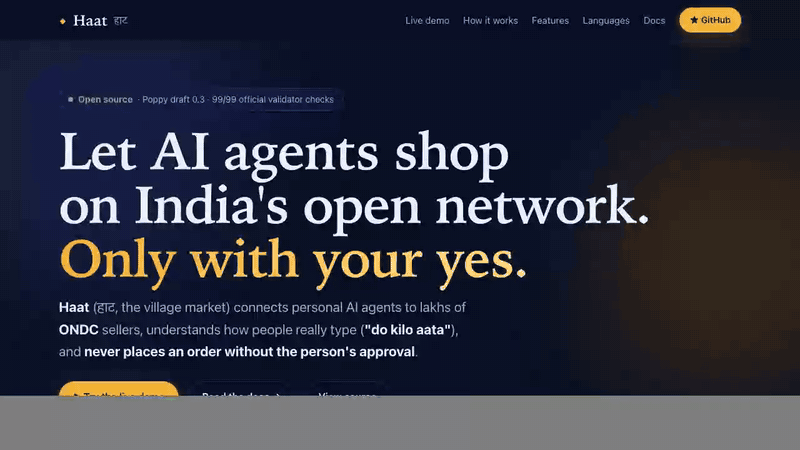

<p align="center">
  
</p>

<p align="center"><b>English</b> | <a href="README.hi.md">हिंदी</a></p>

<p align="center">
  <a href="https://github.com/techsaurabh-394/haat-gateway/actions/workflows/ci.yml"></a>
  
  
  
  <a href="CONTRIBUTING.md"></a>
</p>

# Haat gateway

<p align="center"><a href="https://techsaurabh-394.github.io/haat-gateway/"><b>Live demo and docs → techsaurabh-394.github.io/haat-gateway</b></a></p>

<p align="center"><a href="https://techsaurabh-394.github.io/haat-gateway/"></a></p>

**Haat** (हाट, the village market) lets personal AI agents shop from sellers on **ONDC**, India's open commerce network, in the language people actually type, and **never places an order without the person's yes**.

It is a [Personal Agent Protocol](https://personalagentprotocol.org/) ("Poppy") Company on one side and an ONDC/Beckn buyer app on the other. Personal agents speak Poppy (Sierra demonstrated it with Meta's Muse); lakhs of Indian sellers speak Beckn. Haat translates between them.

```text
"do kilo aata aur 1 litre doodh"  ->  2 x Whole Wheat Atta 1 kg, 1 x Toned Milk 1 L, Kashi Kirana Store, Lanka
                                   ->  "Total ₹197, pay on delivery. Approve?"  ->  yes  ->  order KKS-1001 (placed once)
```

## Why this exists

Poppy was announced on 6 October 2026 by Sierra and Meta as an open standard for personal agents working with businesses. Big consumer agents are adopting it. Small Indian sellers will not implement a new US-designed protocol one by one, so without a bridge they become invisible to the agents their customers use. ONDC already gives them machine-readable catalogs and structured orders. Haat connects the two.

When I searched (1 November 2026), I found Poppy SDKs and gateways, and separate ONDC MCP servers, but nothing connecting Poppy to ONDC or Beckn. That is a search result, not proof; if you know of related work, please open a discussion.

## What works today (v0.2)

| Area | What it does |
| --- | --- |
| Poppy discovery | `/.well-known/poppy.json` (draft 0.3) with scopes and scope hints, OpenAPI 3.1, protected resource and authorization server metadata |
| Sessions | Verifies every `Poppy-Session` JWT: ES256 **and PS384** delegations, `aud`/`htm`/`htu`/`iat`/`ath`, replay (`jti`), Session continuity, one account per Session, HTTPS-only fetching that refuses private addresses |
| Sign-in | OAuth Direct Sign-In with PKCE, `private_key_jwt` client assertions (ES256/PS384, `aud` = issuer, `jti` replay), `iss` on every redirect, refresh, revocation (sign-out), scopes enforced |
| Approval gate | Operations extension v2: the person approves one exact revision; the order runs **at most once, even across restarts**; an unknown outcome answers `503 Retry-After`, never "failed" |
| API | Search, place order (guest or account, saved addresses), list, track, cancel (cancel also needs approval) |
| Conversations | Events, cursors, long polling, **server-sent events with `Last-Event-ID`**, idempotent message IDs, handoff, close, sign-in events (8.11), operations in messages |
| Task coverage | Excluded-tasks document and feedback endpoint (section 9) |
| Indian languages | 130 grocery products in Hindi, Bhojpuri, Marathi, Bengali, Tamil, Telugu, Gujarati, Kannada, Malayalam, Punjabi and Odia, in each script and in Latin letters ("2 kilo aata", "दो किलो आटा", "இரண்டு கிலோ அரிசி", "aadha kilo paneer"). Only Hindi was written by hand; the rest is machine-drafted and **needs native-speaker review** ([details](docs/lexicon.md)) |
| Basket | Pack sizes that waste least, and the single seller covering most of the list |
| Storage | SQLite (`node:sqlite`, no dependency) or bounded memory; caps on every namespace |
| Beckn buyer app | Ed25519 + BLAKE2b-512 signing, registry lookups (mock or **signed ONDC v2**), search fan-out, select, init, confirm, status, cancel |
| ONDC onboarding | Key generation, signed `request_id`, `/ondc-site-verification.html`, `/on_subscribe` (AES-256-ECB over X25519), subscribe template, following ONDC's official reference code |
| Deploy | Dockerfile (no `npm install` needed), docker compose, `.env.example` |

**Verified:**
- 126 automated tests (unit and end to end over real HTTP), all passing; lint and typecheck clean.
- The **official Personal Agent Protocol validator**, run over real HTTPS: **99 checks passed, 0 failed, 0 warnings**. The 22 skipped checks are for features Haat doesn't offer (MCP, browser join, Device and Mediated Sign-In). See the [results](docs/conformance/official-validator-results.txt), and reproduce with `scripts/conformance/run-official-validator.sh`.

**Not done:** a live connection to ONDC (needs your legal entity, whitelisting and ONDC's approval), a real SMS provider for sign-in codes, a staffed handoff. See [limitations](docs/limitations.md).

## Run it in one minute

```bash
git clone https://github.com/techsaurabh-394/haat-gateway.git
cd haat-gateway
npm install        # dev tools only (TypeScript); there are no runtime dependencies
npm run demo       # interactive: you approve the order in your terminal
```

You need Node.js 22.18 or newer (TypeScript runs natively, no build step). `npm run demo -- --yes` approves automatically, `npm start` keeps a local network running, `npm run check` runs typecheck, lint and tests. With Docker: `docker compose up --build`.

## How it works

<p align="center"></p>

<p align="center"></p>

<p align="center"></p>

<p align="center"></p>

More detail: [architecture](docs/architecture.md) and the [Poppy to Beckn mapping](docs/protocol-mapping.md).

## Documentation

- [Quickstart and API](docs/quickstart.md)
- [Architecture](docs/architecture.md), with Mermaid flowcharts
- [Protocol mapping: Poppy to Beckn](docs/protocol-mapping.md)
- [Security model](docs/security.md)
- [Limitations, stated plainly](docs/limitations.md)
- [Domain packs](docs/domain-packs.md) and the [language lexicon](docs/lexicon.md)
- [Going live on ONDC](docs/going-live.md): step by step, with what is unverified
- [Conformance](docs/conformance.md): the official validator, how to rerun it
- [Roadmap](ROADMAP.md)
- [Repository audit and what not to do](docs/AUDIT.md)

## Contribute

Most contributions need no TypeScript. You can teach the lexicon how your city spells *pyaz*, review the machine-drafted Tamil, Bengali, Marathi or other language data, add a domain pack, add a mock seller from your neighbourhood, or improve the docs. Start with [CONTRIBUTING.md](CONTRIBUTING.md) (your first PR in about 10 minutes) and the issues labelled [`good first issue`](https://github.com/techsaurabh-394/haat-gateway/labels/good%20first%20issue).

## Contributors

Everyone who helps is credited here, for code, docs, language data and reviews ([all-contributors](https://allcontributors.org/)).

<!-- ALL-CONTRIBUTORS-LIST:START - Do not remove or modify this section -->
<!-- ALL-CONTRIBUTORS-LIST:END -->

## Project status

Early (v0.2). The Poppy spec is a draft that changes quickly (0.1 to 0.3 in October 2026), so expect breaking changes. Nothing here has touched a real seller or real money. Before any public deployment, read [going live](docs/going-live.md): sign-in needs a real SMS provider, and ONDC needs your registration.

## Author

Built by **Saurabh Pathak**, AI engineer and full-stack developer from Varanasi.
[GitHub](https://github.com/techsaurabh-394) · [LinkedIn](https://linkedin.com/in/tech-saurabh) · [Blog](https://mernstackdev.com) · [X](https://x.com/Saurabh23272258)

If Haat helps you, you can [buy me a coffee](https://buymeacoffee.com/saurabhdev).

Haat is independent and is not affiliated with ONDC, Sierra, Meta or the Personal Agent Protocol project. "Poppy" and "Personal Agent Protocol" refer to the open specification at personalagentprotocol.org (Apache-2.0).

Licensed under the [MIT License](LICENSE).
