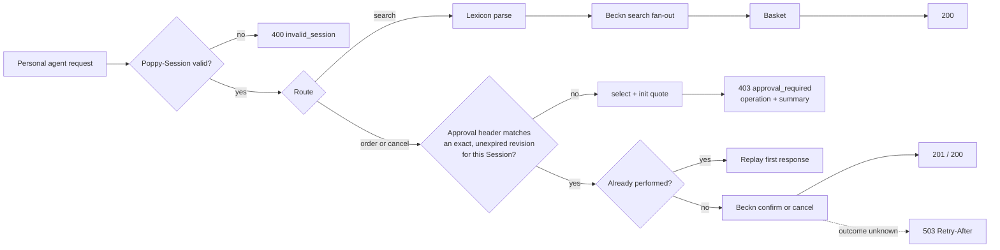
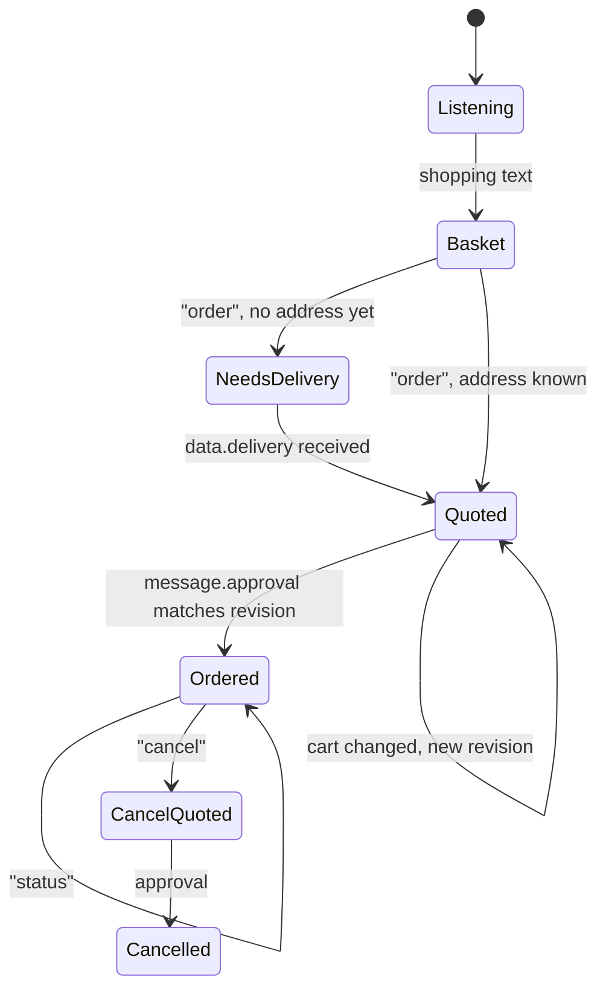

# Architecture

Haat has three layers. Each one depends only on the one below it.

| Layer | Folder | Responsibility |
| --- | --- | --- |
| Poppy | `src/poppy` | Everything a Personal Agent sees: discovery, Session verification, the approval gate, conversations |
| Commerce | `src/commerce`, `src/lexicon` | Understanding requests, building baskets, turning them into quotes and orders, the Company Agent |
| Beckn | `src/beckn` | Signed messages to and from the ONDC network |

`src/gateway.ts` wires them to HTTP routes. `src/util/http.ts` is a 150-line router on `node:http`, so the project has no runtime dependencies to audit.

## Request lifecycle

## Why a gateway and not an MCP server

ONDC MCP servers already exist. They give an agent tools, but each agent then has to implement Beckn signing, registry trust, and its own idea of when to buy. Poppy moves the decision point to the Company: the Company says which actions need approval and guarantees at most once. Putting that in one audited gateway means every Poppy agent gets the same safety without trusting each agent's tool use.

## The Company Agent

`src/commerce/assistant.ts` answers conversations. It is rule-based on purpose: replies are deterministic, testable, and no language model ever touches keys, Session JWTs or the approval step. A local open-weight model for intent detection is on the [roadmap](../ROADMAP.md); the approval logic would stay outside the model.

## Data that is not code

- `packs/<domain>/pack.json` and `lexicon.json`: domains and language data, validated at startup (`src/commerce/packs.ts`).
- `mock-network/sellers/*.json`: mock seller catalogs.
- `scripts/assets/make_diagrams.py`: source of the diagrams in `assets/`.
