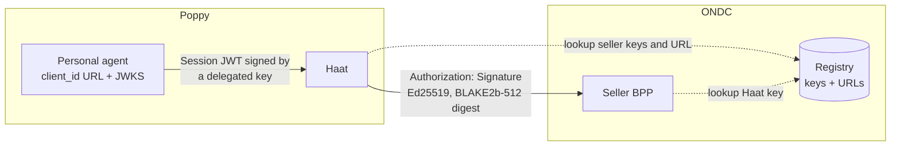

# Protocol mapping: Poppy to Beckn

Haat is a Poppy **Company** (draft 0.3) and a Beckn **BAP** (buyer app) at the same time.

| Poppy (Personal Agent side) | Haat does | Beckn / ONDC (seller side) |
| --- | --- | --- |
| `GET /.well-known/poppy.json` | Publishes channels and the `operations` extension | — |
| `Poppy-Session` header on every request | Verifies (5.3); maps `sid` to Session state and `sub` to the User | Never forwarded |
| `GET /api/v1/search?q=…` | Lexicon parse, one search per item | `search` via the gateway; many `on_search` callbacks collected for a short window |
| `POST /api/v1/orders` (no approval) | Builds a quote | `select` → `on_select` (price, stock), `init` → `on_init` (delivery, payment terms) |
| `403 approval_required` + operation | `summary` from the seller's own quote; `terms` as JSON | — |
| `POST /api/v1/orders` + `Poppy-Approval` | Checks Session, revision, expiry and cart fingerprint | `confirm` → `on_confirm`, **once** |
| `GET /api/v1/orders/{id}` | Owner check by User | `status` → `on_status` |
| `POST /api/v1/orders/{id}/cancel` | Separate operation and approval | `cancel` → `on_cancel` |
| Conversation message with `operation` | Same gate as the API, owned by the conversation | as above |
| Conversation message with `approval` | Performs the conversation's operation | `confirm` |

## Identity on each side

- The agent's keys never reach sellers, and Haat's Beckn key never reaches agents.
- A seller's URL always comes from the registry, never from the agent's request.
- Sellers call back only to the `bap_uri` the registry lists for Haat.

## Signed in and signed out

| | Signed out (Session header only) | Signed in (Session header + access token) |
| --- | --- | --- |
| Orders belong to | the User ID at this agent | the account, across Sessions and agents |
| Operations belong to | the Session | the account (Operations section 3) |
| Delivery address | sent in each order | sent, or a saved `delivery_address_id` |
| Conversations | the agent + User ID | the account, once it used the account (8.2) |

Guest orders a User placed through an agent move to the account the first time that User signs in through it.

## Payment

v0.1 uses `ON-FULFILLMENT` payment collected by the seller (cash or UPI on delivery). The agent and Haat never hold money. The approval summary states the amount and the payment method before anything is ordered. Prepaid flows are on the roadmap and need ONDC's settlement rules to be checked first ([going live](going-live.md)).
